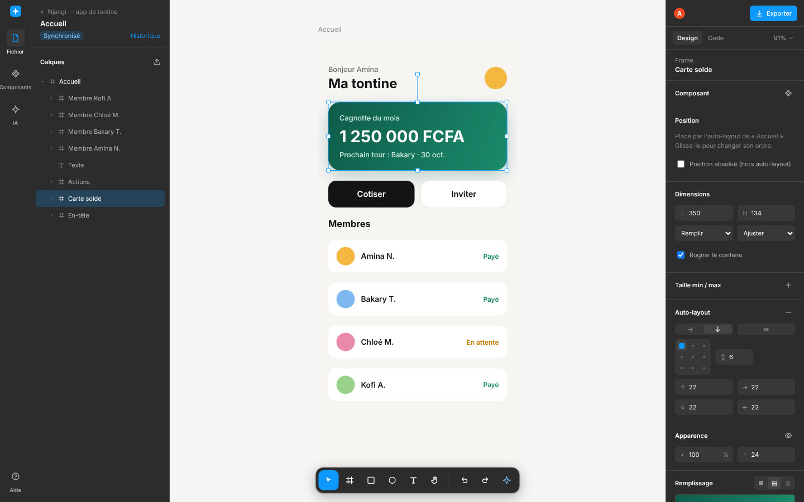

<p align="center"><b>✦ Swiftma</b></p>

<p align="center">
  <b>The open-source, AI-native interface design tool you host yourself.</b><br>
  <b>English</b> · <a href="README.fr.md">Français</a> · <a href="#quick-start">Quick start</a> · <a href="docs/hub.md">Hub contract</a> · <a href="CONTRIBUTING.md">Contributing</a>
</p>

<p align="center">
  <a href="LICENSE"></a>
  <a href="https://github.com/FranckALPHA/swiftma/actions/workflows/ci.yml"></a>
  
  
</p>



## Why Swiftma

Design tools became per-seat subscriptions hosted somewhere else, where your mockups, your components and your
know-how live with a vendor. Meanwhile, AI agents can now read, draw and write code. Value is moving away from the
rented seat and toward **your data, open tools and the agents that use them**. Many call this shift the
*SaaSpocalypse*.

Swiftma is our answer. It is built in Cameroon and meant to be useful anywhere:

- **Sovereign.** One Docker image on your own server: a school, a company, a public administration or a VPS. Your
  files stay with you, in a SQLite database you can back up and read.
- **AI is a first-class user.** A built-in **MCP** server lets Claude Code, Claude Desktop, Cursor or any compatible
  agent draw in your files **with the same tools you use**. It works live, and only with your permissions.
- **From design to code.** Export to React (one component per element, responsive flexbox, design tokens) or to
  HTML/CSS.
- **Free for good.** Swiftma is licensed under the **AGPL-3.0**. Anyone who offers a modified version online must
  publish its source, so improvements come back to everyone.

Swiftma is static and lightweight: frames, shapes, vectors, images, text, colors, gradients, shadows and corner
radius. It does no animation and no prototyping, on purpose.

## Features

| | |
|---|---|
| **Humans and AI, both ways** | Paste a screenshot and the built-in agent rebuilds it as editable layers. A text prompt gives you a design. MCP tools serve external agents. |
| **SVG import** | Figma, Illustrator and Inkscape exports become editable mockups, with layer names, masks, gradients, shadows, blurs and Google Fonts. Pixel-diff against Figma exports: under 1%. |
| **Auto-layout and constraints** | Figma-style auto-layout (direction, gap, padding, alignment, wrap, fill/hug sizing), constraints, and min/max sizes. *Make responsive* converts an imported mockup automatically. |
| **Components and variants** | Main components, instances with preserved overrides, and variants. They export as real React components with props. |
| **Shared styles** | Color, text and shadow styles act as design tokens, exported as CSS variables. |
| **Plugins** | Web pages in a sandboxed iframe that draw with the same tools as the AI and MCP (undoable, live, permission-checked). Ships with Iconify (200,000+ icons). Anyone can write one: [docs/plugins.md](docs/plugins.md). |
| **Projects and real-time collaboration** | Several people and AIs can work in the same file, with live cursors and selections. Each person has their own undo, and simultaneous edits converge. |
| **Version history** | Named versions plus autosaves, all restorable. |
| **Accounts and permissions** | Projects are shared with viewer, editor or owner roles. Personal access tokens serve AI agents. Removing someone's access takes effect live. Admins create password-reset links. |
| **Self-hosting** | A Rust backend (axum and SQLite) with a single Docker image. An optional `https` profile adds Caddy with automatic certificates. |

## Quick start

### With Docker

```bash
docker compose up -d        # → http://localhost:4000 (editor, API and MCP on one port)
```

The first account you create becomes the **administrator** and owns the existing projects.

### Online, with HTTPS (automatic certificate)

On a server whose domain name points to it, with ports 80 and 443 open:

```bash
cp .env.example .env                     # set SWIFTMA_DOMAIN and SWIFTMA_PUBLIC_URL
docker compose --profile https up -d     # → https://your-domain (Caddy + Let's Encrypt)
```

`.env.example` already sets `SWIFTMA_SECURE_COOKIES=1` and closes sign-ups (`SWIFTMA_SIGNUP=closed`), so the admin
invites everyone else. Keep port 4000 closed to the public, because Caddy handles all traffic. If you use another
proxy such as Nginx, make sure it also forwards WebSockets (`/ws`).

If an admin is locked out of their own account, run this on the server to get a one-time reset link:

```bash
docker compose exec swiftma swiftma-hub reset-password admin@example.org
```

### From source

Requirements: Node 22 and stable Rust.

```bash
npm install
npm run dev        # Rust hub (:4000) + MCP/AI service (:4001) + editor (:5173)
```

Then open http://localhost:5173. To run the built-in screenshot-to-design agent, set `ANTHROPIC_API_KEY` first; MCP
works without it.

## Connect an AI agent (MCP)

1. In Swiftma, open the account menu, then **Access tokens**, then **Create a token**.
2. Add the server to your agent. For example, with Claude Code:

```bash
claude mcp add --transport http swiftma http://localhost:4000/mcp \
  --header "Authorization: Bearer swiftma_…"
```

3. Ask for something, for example: *"In Swiftma, design a sign-in screen for a tontine app, in auto-layout, with a
   Button component that has two variants."* The agent works on the file you have open, and you watch it draw.

It has 26 tools, among them `create_nodes`, `update_nodes`, `add_auto_layout`, `group_nodes`, `make_responsive`,
`create_component`, `combine_as_variants`, `set_style`, `export_react` and `export_code`.

## Architecture

```
packages/core     Document model, operations (with undo), auto-layout, constraints, components, shared styles,
                  DESIGN TOOLS, React and HTML/CSS exports (TypeScript)
apps/hub          Rust backend (axum, SQLite): accounts, projects, files, versions, real-time collaboration;
                  serves the built editor and proxies the MCP/AI service. Contract: docs/hub.md
apps/server       MCP/AI service (TypeScript): MCP server (/mcp) and the screenshot-to-design agent
apps/editor       React + Konva editor: projects screen, canvas, layers, components, properties, code
```

```
 Editor ──WebSocket──┐          ┌──────────────┐
 Editor ──WebSocket──┼─────────▶│  Hub (Rust)  │── SQLite
 AI (MCP) ──/mcp─────┘          └──────┬───────┘
                                       │ proxies /mcp and /api/ai/*
                                MCP/AI service (Node)
```

The key idea is that **design tools are defined once**, in `packages/core/src/tools.ts`. Three kinds of users share
them:

- **People** use them through the editor. Their changes become operations sent over the hub's WebSocket.
- **The built-in agent** uses them through the Claude API, with tool use, and calls the hub API.
- **Any external AI** uses them through MCP, which also calls the hub API.

Every change is an **operation** (`create`, `update`, `delete`, `move`, `set-doc`).

1. The client applies the design rules (auto-layout, instances, styles) and sends a **resolved** batch.
2. The hub knows nothing about design, so it applies the batch generically.
3. It broadcasts the batch to everyone in the file and records it in its author's history.

## Tests

```bash
npm test                 # core: layout, constraints, components, styles, resolved batches
npm run test:hub         # Rust hub: API, WebSocket, accounts, permissions, password reset
npm run fidelity -- dir  # pixel-by-pixel fidelity bench against SVG exports (tests/fidelity/README.md)
node tests/e2e/collaboration.mjs   # with `npm run dev` running: 3 people + an AI on one file
```

CI (`.github/workflows/ci.yml`) runs all of these, builds the Docker image and checks it.

## Roadmap

- [x] Auto-layout, responsive code, constraints, min/max sizes
- [x] Components, variants, shared styles (design tokens)
- [x] Projects, real-time collaboration, version history (Rust hub)
- [x] Accounts, per-project roles, access tokens for AI agents
- [x] Password reset links, live permission revocation, automatic HTTPS (Caddy)
- [ ] AI-generated UML diagrams (merging Easy Analyst: use cases, classes, sequences, activities)
- [ ] `get_screenshot` tool, so the AI can see its own render and fix it
- [ ] Pen tool and vector point editing
- [ ] Flutter and Jetpack Compose export
- [ ] Offline mode (PWA) and local models, for full data sovereignty
- [ ] Optional SMTP for emailing reset links

## Contributing

Contributions of any kind are welcome: code, translations, feedback, test mockups. Please read
[CONTRIBUTING.md](CONTRIBUTING.md) and the [Code of Conduct](CODE_OF_CONDUCT.md). To report a security issue, see
[SECURITY.md](SECURITY.md), and never use a public issue for it.

## License

Swiftma is free software under the [GNU Affero General Public License v3.0](LICENSE). You may use, study, modify
and redistribute it. If you let users interact with a modified version over a network, for example as an online
service, you must give them access to its source code. The editor shows a "Source code" link for this purpose.
